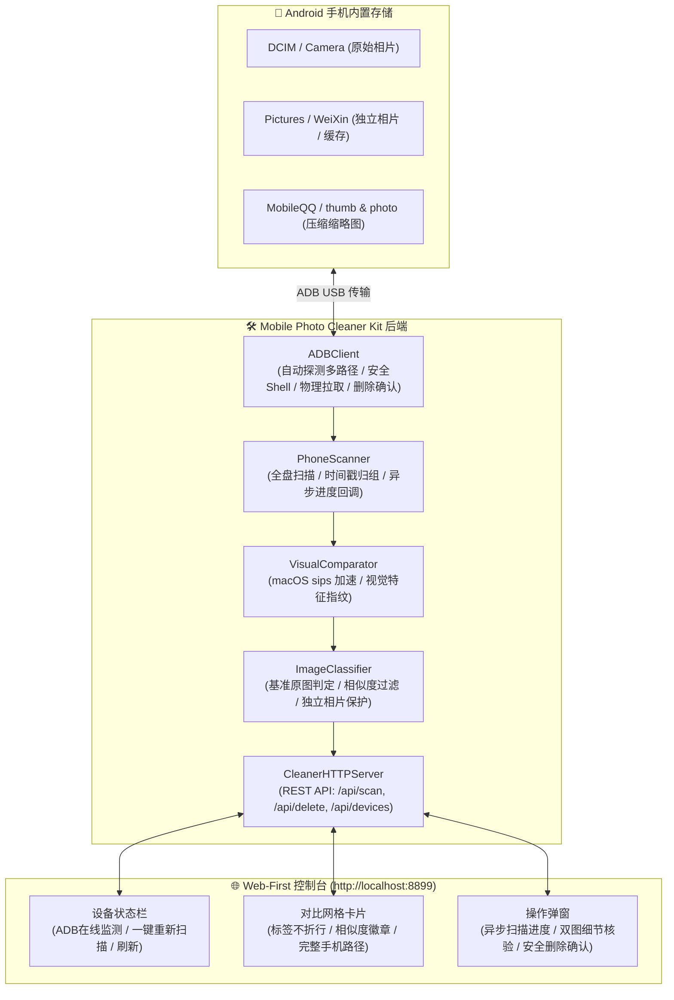

# 📱 Mobile Photo Cleanup Kit (手机相册对比清理工具包)

> 一款基于 **Web-First** 交互理念设计的 Android 手机相册重复文件与缩略图清理套件。
> 所有操作（ADB 设备检测、全盘扫描、视觉指纹比对、核验与删除）均可在网页端一键掌控。
> 项目提供 macOS/Linux 与 Windows 双平台一键启动脚本，免安装第三方依赖，直接拉起 Web 界面。

---

## 🌟 核心特性与改进

1. **🎨 焕新 UI/UX 体验，杜绝折行错乱**：
   - 彻底优化卡片头部与状态徽章排版，标签、匹配度与状态横向弹性对齐，字字清晰不重叠。
   - **手机真实完整路径 100% 呈现**：取消所有省略号截断（`truncate`），专设完整路径代码展示区，支持自动换行与一键复制到剪贴板，方便用户绝对安全核验。
2. **🌐 Web-First 全流程操控**：
   - 手机连接检测、全量重新扫描、视觉阈值调节、缓存清理均在网页端完成。
   - 内置**实时扫描进度浮层**，直观显示全盘扫描、图片拉取与指纹比对阶段百分比与当前处理文件名。
3. **👁️ 视觉指纹一致性验证（核心保护机制）**：
   - **核心准则**：*跨目录重复必须确认是相同图片才算，同文件名绝不算重复！*
   - macOS 硬件加速计算感知特征向量与皮尔逊相关系数（Pearson Correlation）。
   - **相似度 $\ge 88\%$**：判定为真实缩略图或 QQ 压缩缓存，系统自动预选推荐删除。
   - **相似度 $< 88\%$**：判定为**独立拍摄相片**（如连拍或同时间戳不同照片），系统赋予**蓝色保护盾牌，强制解除勾选并保护**！
4. **🖱️ 双平台一键启动脚本**：
   - **macOS / Linux**：双击或终端运行 `./start.sh`，自动调起本地服务并唤起默认浏览器。
   - **Windows**：双击运行 `start.bat`，自动拉起服务并在浏览器中打开控制台。

---

## 🚀 启动方式

### 方案 A：一键脚本直接启动 Web（推荐）

#### 🍎 macOS / 🐧 Linux 用户：
```bash
# 在终端中执行（或双击 start.sh）
./start.sh
```

#### 🪟 Windows 用户：
直接双击运行项目根目录下的 **`start.bat`**。

---

### 方案 B：CLI 命令行进阶使用

```bash
# 启动 Web 服务 (默认端口 8899)
./cleaner serve

# 检测 ADB 连接状态
./cleaner status

# 命令行单独执行扫描 (支持自定义相似度阈值)
./cleaner scan --threshold 0.88
```

---

## 🏗️ 架构设计



---

## 📂 项目工程目录结构

```
excited-hypatia/
├── start.sh                     # 🚀 macOS / Linux 一键直接启动 Web 脚本
├── start.bat                    # 🚀 Windows 一键直接启动 Web 脚本
├── cleaner                      # 🛠️ 命令行入口脚本 (CLI)
├── pyproject.toml               # Python 项目打包与安装配置
├── README.md                    # 项目工程说明文档
├── phone_cleaner/               # 核心工程包
│   ├── __init__.py
│   ├── __main__.py              # 支持 python3 -m phone_cleaner 执行
│   ├── cli.py                   # 命令行参数解析与子命令路由
│   ├── config.py                # 全局配置 (ADB 探测、端口、相似度阈值、路径白名单)
│   ├── core/
│   │   ├── __init__.py
│   │   ├── adb.py               # ADB 客户端封装 (命令执行、文件拉取、安全校验删除)
│   │   ├── comparator.py        # 视觉内容比对引擎 (sips 硬件加速指纹、皮尔逊相关度)
│   │   ├── classifier.py        # 规则分类引擎 (原图甄选、真实缩略图判定、独立相片保护)
│   │   └── scanner.py           # 扫描流水线 (异步进度支持、全盘发现、批量拉取)
│   ├── server/
│   │   ├── __init__.py
│   │   ├── app.py               # 异步任务支持的 HTTP 服务端 (REST API + 静态文件服务)
│   │   └── static/
│   │       └── index.html       # 🌟 优化后的现代化 Web-First 前端 (Vue 3 + Tailwind CSS)
│   └── utils/
│       ├── __init__.py
│       ├── helpers.py           # 尺寸格式化、时间戳处理、分辨率提取、路径安全检查
│       └── logger.py            # 终端彩显与格式化日志
├── temp_images/                 # 本地临时图片缓存与 manifest.json (按时间戳分组存储)
└── tests/                       # 单元测试集
    └── test_comparator.py       # 核心算法与路径安全单元测试
```

---

## 🔒 生产级安全防护

1. **同名不同图绝对保护**：
   - 彻底避免传统去重工具“仅看文件名或仅看时间戳”导致的误删惨剧。视觉相似度 $<88\%$ 一律判定为独立相片，自动解除勾选。
2. **手机路径白名单机制**：
   - 严禁在 `/storage/emulated/0` 以外的任何目录执行删除操作，拒绝任何 `..` 路径穿越请求。
3. **真实删除后置物理校验**：
   - 每次调用 `rm` 指令后，直接在手机端执行 `[ ! -f path ]`，确认物理消失后才更新状态并返回成功。
